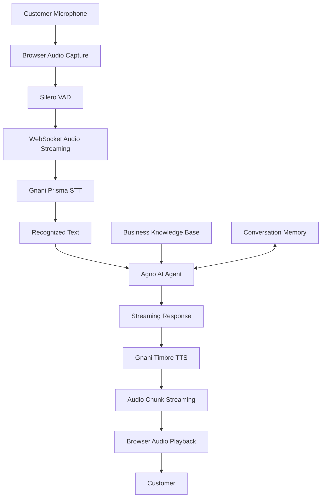

# 🎙️ Real-Time Conversational Voice Agent

An AI-powered, real-time conversational voice assistant built for **ABC Clothing Store**, designed to handle customer enquiries through natural Hindi, English and Hinglish voice conversations.

The system combines speech recognition, AI-powered reasoning, and speech synthesis to create a conversational customer-support experience with low-latency audio interaction.

<p align="center">
  <strong>Listen → Understand → Reason → Respond</strong>
</p>

---

## 🚀 Project Overview

Traditional customer support systems often depend on human availability and manual handling of repetitive enquiries.

This project aims to automate first-level customer support using an AI voice agent that can:

- Understand customer speech in real time.
- Convert speech into text using Gnani Prisma STT.
- Process customer queries using an Agno-powered AI agent.
- Generate natural voice responses using Gnani Timbre TTS.
- Support Hindi, English and Hinglish conversations.
- Maintain conversation context through session-based memory.
- Handle interruptions through Voice Activity Detection (VAD).
- Collect customer enquiry details.
- Provide business information and customer-support guidance.

The project uses ABC Clothing Store as its demonstration business.

## ✨ Key Features

### 1. Real-Time Speech Recognition
- Integrates Gnani Prisma STT.
- Supports Hindi and English speech recognition.
- Uses a streaming WebSocket connection for audio input.
- Processes incoming microphone audio as PCM audio frames.

### 2. AI-Powered Conversational Engine
- Built using the Agno agent framework.
- Uses Groq-hosted LLM inference.
- Generates responses based on business knowledge.
- Maintains session-based conversation history.
- Supports streaming text generation.

### 3. Natural Speech Generation
- Integrates Gnani Timbre TTS.
- Generates spoken responses from AI-generated text.
- Supports audio chunking for progressive response playback.
- Uses PCM audio output for browser playback.

### 4. Voice Activity Detection
- Integrates Silero VAD through the browser.
- Detects when the user starts and stops speaking.
- Helps manage turn-taking in voice conversations.
- Supports interruption detection and audio-buffer flushing.

### 5. Conversation Management
- Maintains customer conversation sessions.
- Stores session information using SQLite.
- Keeps track of previous interactions.
- Supports conversation-level context.

### 6. Business Knowledge Integration

The assistant uses a structured business knowledge base containing:

- Product categories.
- Wholesale and retail policies.
- Pricing and quotation guidelines.
- Stock availability rules.
- Delivery and payment policies.
- Return and damage policies.
- Human-support escalation rules.

### 7. Customer Enquiry Handling

The agent can collect:

- Customer name.
- Contact number.
- Product category.
- Order quantity.
- Preferred sizes.
- Colour preferences.
- Delivery city.

The human team retains final authority over quotations, stock verification and order confirmation.

---

## 🏗️ System Architecture



### Conversation Flow

1. The customer speaks through the browser microphone.
2. Browser-side VAD helps identify speech activity.
3. Audio frames are transmitted to the backend through WebSocket.
4. Gnani Prisma STT converts speech into text.
5. The recognized text is processed by the Agno agent.
6. The agent generates a response using the LLM and business context.
7. Gnani Timbre TTS converts the response into audio.
8. Audio chunks are streamed back to the browser.
9. The customer hears the assistant's response.

---

## 🛠️ Technology Stack

| Component | Technology |
|---|---|
| Programming Language | Python, JavaScript |
| Backend Framework | FastAPI |
| AI Agent Framework | Agno |
| LLM Inference | Groq |
| Speech-to-Text | Gnani Prisma STT |
| Text-to-Speech | Gnani Timbre TTS |
| Voice Activity Detection | Silero VAD |
| Real-Time Communication | WebSocket |
| Database | SQLite |
| Frontend | HTML, CSS, JavaScript |
| Deployment | Render |

---

## 📁 Project Structure

```text
Voice-Agent/
│
├── app.py
├── requirements.txt
├── business_info.txt
├── .env
├── .gitignore
│
├── frontend/
│   ├── index.html
│   ├── style.css
│   ├── app.js
│   ├── vad.js
│   └── tts_playback.js
│
└── voice_agent_data/
    ├── abc_agent_sessions.db
    └── agent_responses.json
```

**Note:** The database and generated response files are runtime data. They should not be committed to the Git repository.

---

## ⚙️ Installation and Setup

### Prerequisites

Make sure you have:

- Python 3.11 or later (Python 3.14 may require compatible package versions).
- Git.
- A Groq API key.
- A Gnani AI API key.
- A modern browser with microphone access.

### 1. Clone the Repository

```bash
git clone https://github.com/YOUR_USERNAME/voice-agent.git
```

```bash
cd voice-agent
```

### 2. Create a Virtual Environment

```bash
python -m venv venv
```

Activate it on Windows:

```bash
venv\Scripts\activate
```

On Linux/macOS:

```bash
source venv/bin/activate
```

### 3. Install Dependencies

```bash
pip install -r requirements.txt
```

### 4. Configure Environment Variables

Create a `.env` file in the project root:

```env
GROQ_API_KEY=your_groq_api_key
GNANI_API_KEY=your_gnani_api_key
```

Replace the placeholders with your actual API credentials.

**Important:** Never upload `.env` or expose API keys in frontend JavaScript or public repositories.

### 5. Run the Application

```bash
uvicorn app:app --reload --host 127.0.0.1 --port 8000
```

### 6. Open the Application

Visit:

```text
http://127.0.0.1:8000/
```

Health check:

```text
http://127.0.0.1:8000/health
```

---

## 🔌 API Endpoints

| Method | Endpoint | Description |
|---|---|---|
| GET | `/` | Serves the frontend |
| GET | `/health` | Checks backend health |
| GET | `/version` | Returns application version |
| POST | `/chat` | Processes text-based chat requests |
| WebSocket | `/ws/voice` | Handles real-time voice conversations |
| WebSocket | `/voice/tts` | Handles standalone TTS interaction |

### WebSocket Communication

The primary voice interaction endpoint is:

```text
/ws/voice?session_id=SESSION_ID&user_id=USER_ID
```

The connection supports:

- Incoming binary audio frames.
- Transcript events.
- Assistant response events.
- Streaming audio output.
- Interrupt signals.
- Stop signals.

---

## 🏪 Demonstration Business: ABC Clothing Store

ABC Clothing Store is a fictional demonstration business offering wholesale and retail clothing.

### Product Categories

- Men's Clothing
- Women's Clothing
- Kids' Clothing
- Winter Wear
- Ethnic Wear

### Business Policies

| Policy | Details |
|---|---|
| Minimum wholesale quantity | 50 pieces |
| Special quotation | Orders above 500 pieces |
| Standard delivery | 5–7 business days |
| Advance payment | 50% |
| Remaining payment | Before dispatch |
| Damage reporting | Within 48 hours |
| Business hours | 10 AM – 7 PM |
| Support email | abd@gmail.com |

### AI Safety and Business Rules

The assistant must:

- Never invent product prices or discounts.
- Never guarantee live stock availability.
- Never confirm or book an order independently.
- Never promise unverified delivery dates.
- Never request OTPs, card details or banking credentials.
- Escalate complaints, payment disputes and special requests to the human team.

---

## ☁️ Deployment

The application is configured for deployment on **Render**.

### Build Command

```bash
pip install -r requirements.txt
```

### Start Command

```bash
uvicorn app:app --host 0.0.0.0 --port $PORT
```

Configure the following environment variables in the Render dashboard:

```text
GROQ_API_KEY
GNANI_API_KEY
```

The frontend and backend can be served from the same FastAPI application.

**Production considerations:**

- Use persistent storage for SQLite data.
- Configure appropriate CORS policies if frontend and backend are hosted separately.
- Keep all API credentials in environment variables.
- Configure secure WebSocket connections (WSS) for HTTPS deployments.
- Monitor API latency, errors and resource usage.

---

## ⚡ Performance Goals

The project focuses on reducing the delay between customer speech and assistant response.

Key optimization areas include:

- Streaming speech recognition.
- Asynchronous LLM processing.
- Streaming text generation.
- Early TTS synthesis.
- Parallel audio chunk generation.
- Browser-side audio buffering.
- Interruption handling and cancellation.

**Target:** Minimize perceived response latency and make conversations feel natural and responsive.

Actual latency depends on network conditions, model inference, speech processing and deployment resources.

---

## 🔮 Future Improvements

- [ ] Reliable full-duplex voice communication.
- [ ] Improved barge-in and interruption handling.
- [ ] Lower first-audio latency.
- [ ] More natural Hindi and Hinglish conversations.
- [ ] Structured customer enquiry storage.
- [ ] CRM integration.
- [ ] Automated email notifications.
- [ ] Live inventory integration.
- [ ] Order-status lookup tools.
- [ ] Telephony integration for incoming customer calls.
- [ ] Persistent production database.
- [ ] Conversation analytics and performance dashboard.

---

## 🔐 Security and Privacy

- API keys must remain server-side.
- Customer contact information should be handled securely.
- Avoid collecting unnecessary personal or financial information.
- Do not log sensitive payment credentials.
- Use HTTPS and WSS in production.
- Apply appropriate database access controls and retention policies.

---

## 👨‍💻 Author

**Himanshu Kumar**

B.Tech – Electronics and Communication Engineering  
School of Engineering, Jawaharlal Nehru University (JNU)

**Areas of Interest:**
- Artificial Intelligence
- Machine Learning
- Agentic AI
- Conversational AI
- Real-Time Voice Systems

---

## 📜 Acknowledgements

- [Gnani AI](https://www.gnani.ai/) – Speech technology.
- [Agno](https://www.agno.com/) – AI agent framework.
- [Groq](https://groq.com/) – LLM inference.
- [Silero](https://github.com/snakers4/silero-vad) – Voice Activity Detection.
- [FastAPI](https://fastapi.tiangolo.com/) – Backend framework.

---

<p align="center">
  <strong>Built to make customer conversations more natural, intelligent and accessible.</strong>
</p>